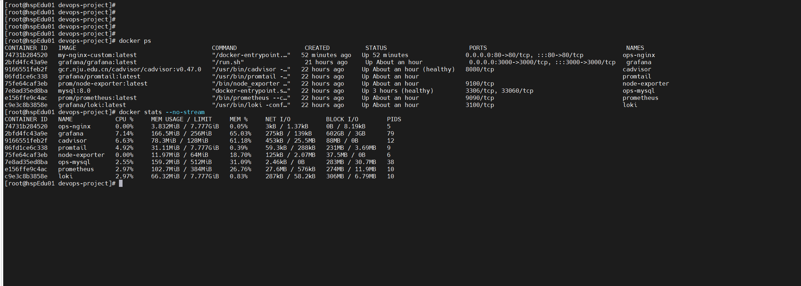
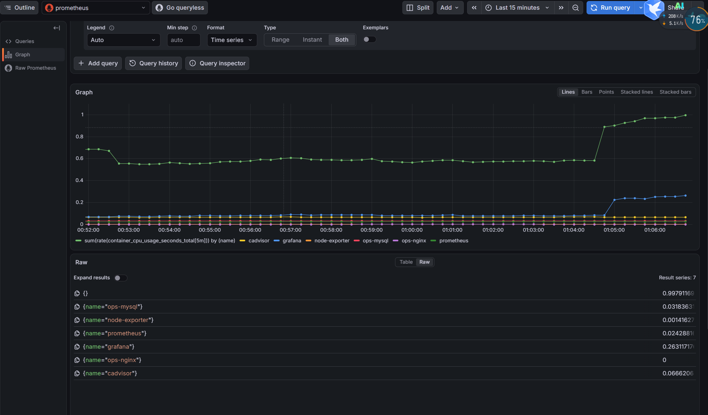
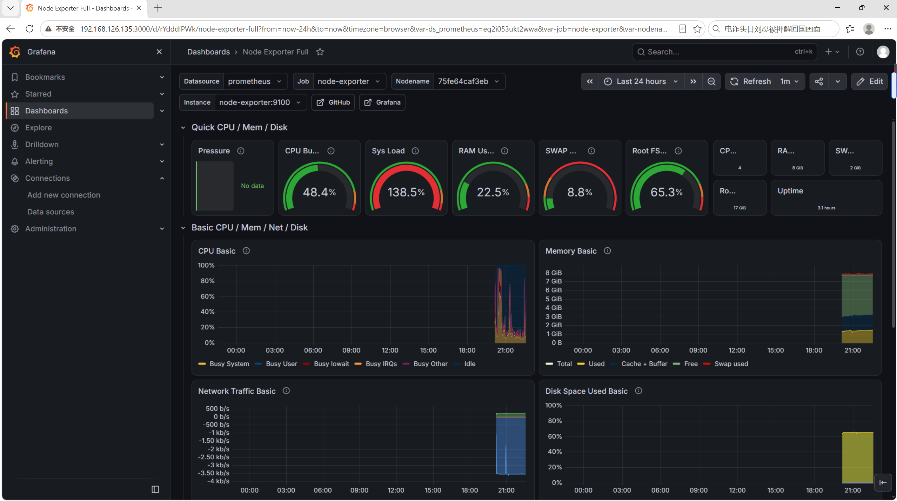
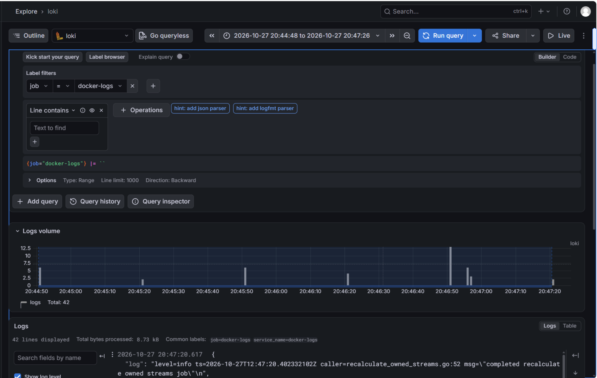
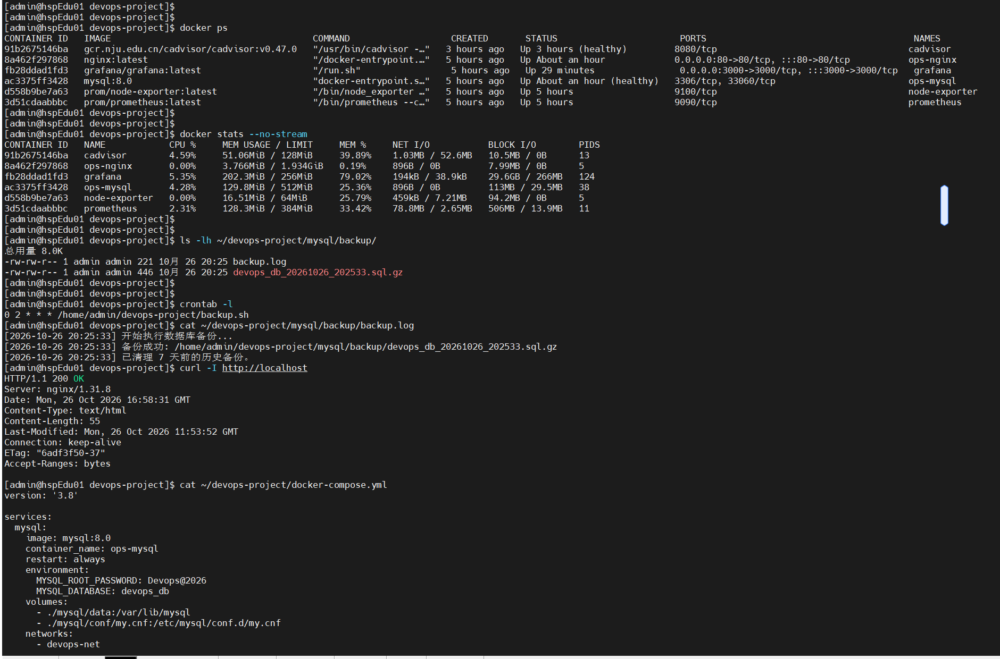
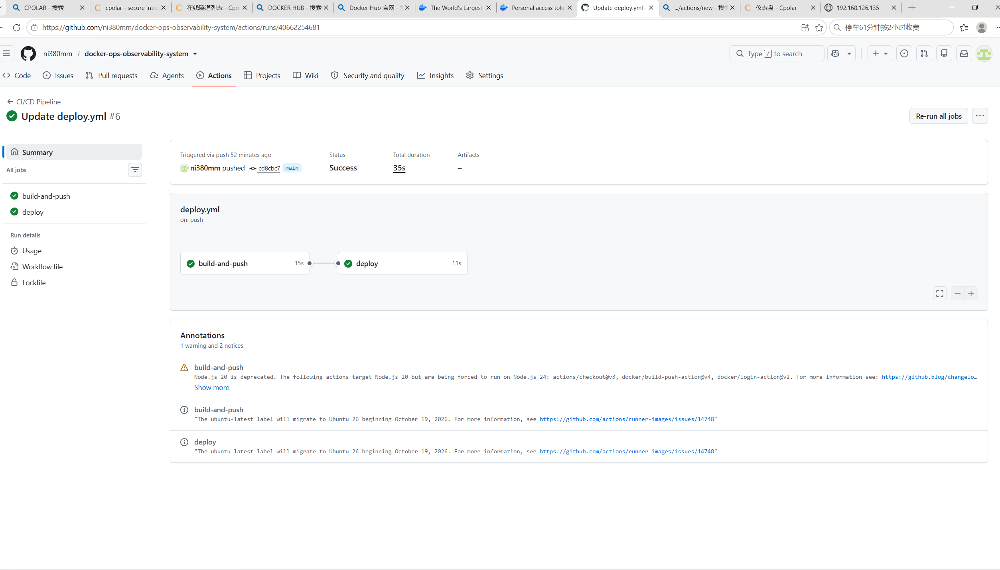
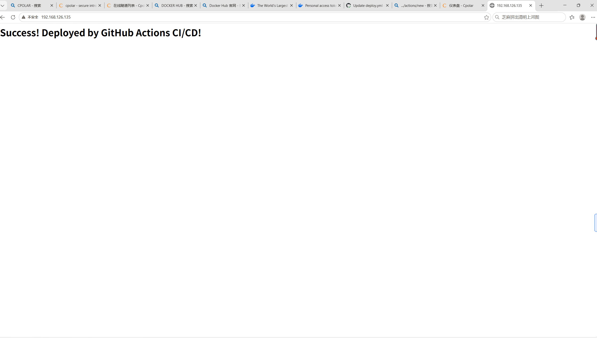

# 🚀 基于 Docker Compose 的轻量级全栈可观测性与自动化交付平台

## 📖 项目背景
在中小型项目及边缘节点中，往往面临服务器资源受限、环境不一致、故障难以排查以及部署繁琐等痛点。本项目在真实的 CentOS 7 环境下（从 2GB 内存极限环境平滑升级至 8GB），基于 `Docker Compose` 构建了一套完整的微服务架构。项目不仅实现了业务的容器化编排，更打通了 **Metrics（指标）与 Logs（日志）** 的全栈可观测性，并最终通过 `GitHub Actions` 实现了 CI/CD 自动化交付闭环。

## 💻 运行环境与核心技术栈
*   **操作系统**：CentOS 7 (Core)
*   **容器与编排**：Docker, Docker Compose
*   **业务服务**：Nginx, MySQL 8.0
*   **指标监控**：Prometheus, Grafana, cAdvisor, Node Exporter
*   **日志聚合**：Grafana Loki, Promtail
*   **持续交付（CI/CD）**：GitHub Actions, Docker Hub, cpolar (内网穿透), SSH

---

## 🔥 核心实战与故障排查记录
本项目最大的价值在于真实解决了大量复杂的工程与网络环境问题：

1.  **突破网络限制（镜像拉取超时）**：针对国内网络拉取 `gcr.io`（cAdvisor 镜像）及 Docker Hub 官方镜像频繁超时的问题，通过配置国内镜像加速器（南京大学源、DaoCloud 等），保障了底层依赖的顺利拉取。
2.  **底层兼容性排错（cgroup 标签丢失）**：在 CentOS 7 (cgroup v1) 环境下，解决新版 cAdvisor 丢失 `name` 标签导致 Grafana 面板全盘 `No Data` 的问题。通过底层 API 抓包分析，最终重写 PromQL 聚合查询成功恢复图表。
3.  **CI/CD 断网降级预案（核心难点）**：在流水线部署阶段，遇到目标服务器因网络阻断无法从 Docker Hub 拉取新镜像（`i/o timeout`）。果断实施降级策略，修改 YAML 部署脚本，跳过 `docker pull`，直接利用服务器本地 Dockerfile 构建镜像并执行 `docker compose up -d`，实现了弱网环境下的平滑更新。
4.  **内网穿透与安全鉴权**：利用 cpolar 将局域网 SSH 端口暴露至公网，结合 RSA 密钥对与 GitHub Secrets 实现安全的自动化 SSH 远程连接，解决了免费版穿透工具端口漂移导致的 `connection refused` 问题。

---

## ✨ 架构与调优亮点
*   **极限资源硬限制**：在 `docker-compose.yml` 中通过 `deploy.resources.limits` 严格控制各容器内存（如 MySQL 限制 512M），防止宿主机 OOM 崩溃。
*   **健康检查与依赖控制**：配置 `healthcheck` 探针与 `depends_on` 机制，确保 MySQL 完全就绪后 Nginx 才开始启动，彻底解决启动死锁。
*   **自动化灾备机制**：编写 Shell 脚本配合 Linux Crontab，实现每日凌晨全量备份 MySQL 数据，自动使用 `gzip` 压缩，并通过 `find` 命令清理 7 天前的历史备份，防止磁盘占满。

---

## 📸 运行效果展示

### 1. 容器状态与资源限制验证
展示 8 个核心容器全部处于 `Up (healthy)` 状态，且 MySQL 等容器被严格限制了内存使用上限（防止 OOM）。


### 2. 全栈指标监控大盘 (Grafana)
基于 Prometheus 采集宿主机与容器指标，在 Grafana 中实现 CPU、内存、网络 I/O 等多维度的可视化监控。

*(备用查看)*


### 3. 日志聚合与检索 (Loki)
引入 Promtail 实时采集全量 Docker 日志并推送至 Loki，在 Grafana 中实现满屏日志流的全文本快速检索，极大提升排错效率。


### 4. 自动化备份验证
展示定时任务成功生成带时间戳的 `.sql.gz` 压缩包，并记录成功日志与清理记录，保障数据安全。


### 5. CI/CD 自动化交付流水线
代码 Push 后自动触发 GitHub Actions，完成镜像构建并推送至 Docker Hub，随后通过 SSH 远程触发服务器更新。

*(最终成果）*

---

## 🚀 快速启动指南
1. **克隆仓库**：
   ```bash
   git clone https://github.com/ni380mm/docker-ops-observability-system.git
